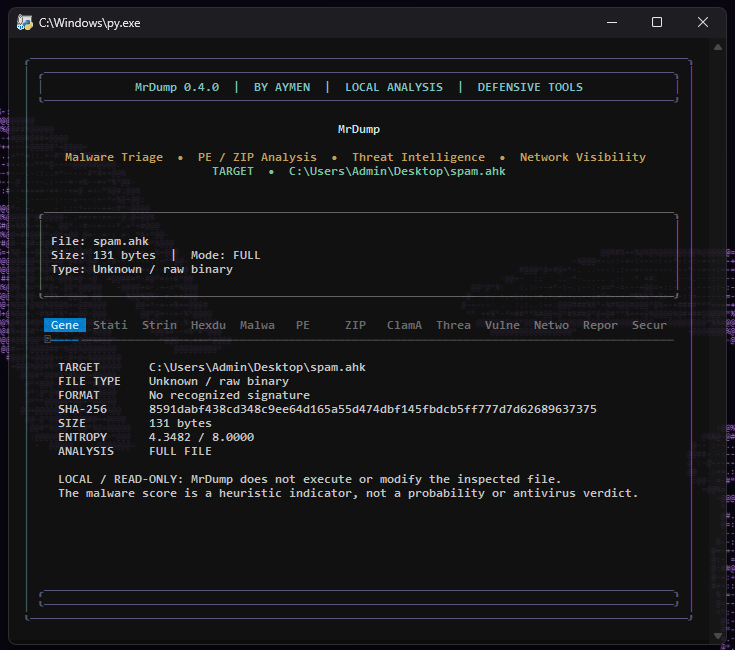
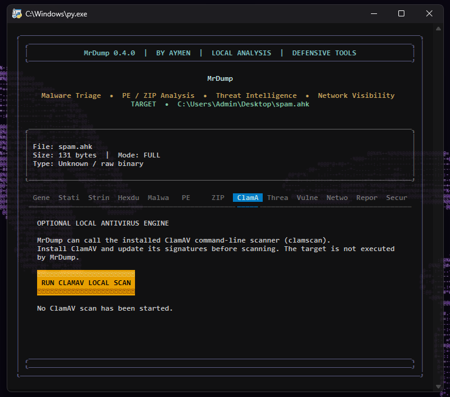
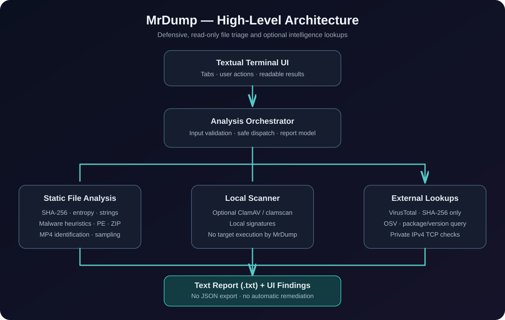

<div align="center">

# MrDump

**Defensive Security Inspection Suite**  
*Created by aymen*

[](https://www.python.org/)
[](https://textual.textualize.io/)
[](https://www.microsoft.com/windows)
[](#license)

A terminal-based, read-only triage tool for inspecting files, reviewing static indicators,
and optionally consulting local or external security engines.

</div>

---

## Interface

<p align="center">
  
</p>

<p align="center">
  
</p>

## Architecture

<p align="center">
  
</p>

## Features

| Module | What it does |
|---|---|
| **General / Static** | File metadata, signatures, SHA-256, entropy, and static triage |
| **Strings / Hexdump** | Extracts printable ASCII and UTF-16LE strings and displays a bounded hex view |
| **Malware** | Heuristic indicators and a triage score; not a definitive malware verdict |
| **PE Analysis** | Validates the PE structure before attempting section and import inspection (`pefile`) |
| **ZIP Analysis** | Reviews archive entries and suspicious names without extracting archive members |
| **ClamAV** | Optional local `clamscan` integration; ClamAV must be installed and its signatures updated separately |
| **Threat Intel** | VirusTotal hash lookup; sends the SHA-256 identifier, not the file contents |
| **Vulnerabilities** | OSV lookup for a specified package, exact version, and ecosystem |
| **Network** | TCP connectivity checks restricted to private, loopback, and link-local IPv4 targets |
| **Reports** | Human-readable `.txt` report export |
| **Security** | Displays safety boundaries and analysis limitations |

## Quick start — Windows

### Requirements

- Windows 10/11
- Python 3.10 or newer, available through the `py` launcher
- Internet access only for online lookups and dependency installation

### Install

1. Download or clone this repository.
2. Extract the project folder.
3. Run `install.bat`.
4. When installation finishes, run `run.bat`.
5. Enter the full path to the file you want to inspect. Quoted paths are accepted.

```bat
git clone https://github.com/larperforce/MrDump.git
cd MrDump
install.bat
run.bat
```

You can also pass the target path directly:

```bat
run.bat "C:\Windows\System32\notepad.exe"
```

## Optional integrations

### VirusTotal

Set your API key in the same Command Prompt session before launching MrDump:

```bat
set VT_API_KEY=YOUR_VIRUSTOTAL_API_KEY
run.bat "C:\path\to\sample.exe"
```

MrDump's VirusTotal integration queries by SHA-256. It does not upload the inspected file through this feature. Hash lookups may still disclose an indicator to the provider; do not query confidential files unless your policy permits it.

### ClamAV

Install ClamAV separately, update its signature database, and ensure `clamscan` is available in `PATH`. Open the **ClamAV** tab and start the local scan from the interface.

## Large-file handling

Files within the configured size threshold are analyzed in full. Larger files use bounded sampling from the beginning and end to limit memory use; the SHA-256 digest is calculated over the complete file. In sampled mode, strings and entropy describe only the sampled regions, and structural PE/ZIP parsing is skipped to avoid presenting partial data as complete analysis.

## Safety model

- MrDump reads the target file; it does not execute it.
- ZIP members are inspected without extracting them.
- Network checks are limited to private, loopback, and link-local IPv4 ranges.
- Network checks are TCP connection tests, not exploitation or authentication attempts.
- Text report export must not overwrite the inspected target.
- External lookups are optional and depend on provider availability, credentials, rate limits, and terms.

## Limitations

MrDump is a **triage assistant**, not a 100% malware detector, EDR, full vulnerability scanner, sandbox, or replacement for professional incident response. Static heuristics can produce false positives and false negatives. A clean result does not prove that a file is safe. ClamAV and online lookups provide additional signals, not certainty.

## Repository layout

```text
MrDump/
├── mrdump.py
├── mrdump_core.py
├── requirements.txt
├── install.bat
├── run.bat
├── test_core.py
├── README.md
├── CHANGELOG.md
├── SECURITY_NOTES.md
└── docs/
    ├── architecture.svg
    └── images/
        ├── mrdump-general.png
        └── mrdump-clamav.png
```

## Tests

Run the core test suite from the project directory:

```bat
.venv\Scripts\python.exe -m unittest -v test_core
```

## License

No license file was included in the supplied project. Add a `LICENSE` file before publishing if you want others to have explicit permission to use, modify, and redistribute the code.
